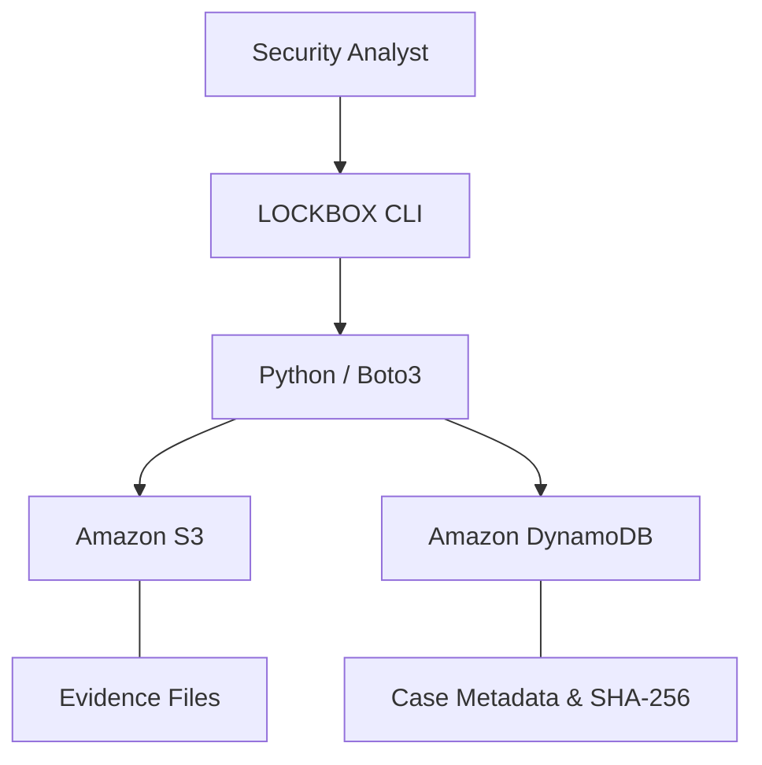

# LOCKBOX

**Cloud-native evidence management, built with Python and AWS.**

LOCKBOX is a lightweight evidence management CLI designed around cybersecurity investigation workflows. It uses Amazon S3 for file storage, Amazon DynamoDB for structured metadata, and Boto3 to connect both services through a single Python application.

Upload evidence, organize investigations, retrieve files, and verify their integrity without managing servers or maintaining a traditional database.

**Stack:** Python · AWS S3 · DynamoDB · Boto3 · AWS CLI

---

## Features

- **Evidence Management** — Upload, retrieve, download, and delete investigation files.
- **Case Organization** — Group evidence by case ID, with unique identifiers for individual artifacts.
- **Cloud Storage** — Store original files in a private Amazon S3 bucket.
- **Metadata Indexing** — Track filenames, descriptions, timestamps, file sizes, and S3 object keys in DynamoDB.
- **Integrity Verification** — Generate SHA-256 checksums on upload and verify files after download.
- **Controlled Deletion** — Require explicit confirmation before removing evidence from S3 and DynamoDB.
- **Error Handling** — Handle missing files, invalid identifiers, nonexistent records, and AWS API errors.

## Architecture

LOCKBOX separates file storage from metadata management, keeping the application simple and the data organized.



**Amazon S3** stores the original evidence files, organized by case and evidence ID.

**Amazon DynamoDB** maintains the metadata required to locate, identify, and retrieve those files.

**Boto3** handles communication between the Python application and AWS services.

### Data Model

DynamoDB table: `LockboxEvidence`

| Attribute | Type | Purpose |
|-----------|------|---------|
| `case_id` | String | Partition key; groups evidence by investigation |
| `evidence_id` | String | Sort key; uniquely identifies evidence within a case |
| `filename` | String | Original filename |
| `description` | String | Evidence description |
| `s3_key` | String | S3 object location |
| `file_size` | Number | File size in bytes |
| `uploaded_at` | String | UTC upload timestamp |
| `sha256` | String | Optional SHA-256 checksum for integrity verification |

The composite primary key supports multiple evidence records per investigation and efficient case-based queries.

### S3 Object Structure

```text
lockbox-evidence-bucket/
└── cases/
    ├── CASE-001/
    │   └── EVD-XXXXXXXXXX/
    │       └── incident-notes.txt
    └── CASE-002/
        └── EVD-YYYYYYYYYY/
            └── endpoint-report.json
```

Unique evidence IDs help prevent filename collisions and keep artifacts associated with their investigations.

---

## Getting Started

### Prerequisites

- Python 3
- AWS CLI and valid AWS credentials
- Amazon S3 bucket with appropriate permissions
- Amazon DynamoDB table
- Boto3

### Installation

From the project directory, install dependencies:

```bash
python3 -m pip install -r requirements.txt
```

### AWS Configuration

Configure the following resources in your AWS account:

1. Create a private S3 bucket with Block Public Access enabled.
2. Create a DynamoDB table named `LockboxEvidence`.
3. Configure `case_id` as the String partition key and `evidence_id` as the String sort key.
4. Update `config.py` with your AWS resource names and Region.

```python
AWS_REGION = "us-east-1"
S3_BUCKET = "your-s3-bucket-name"
DYNAMODB_TABLE = "LockboxEvidence"
```

LOCKBOX uses Boto3's default AWS credential provider chain. Credentials should be configured through supported AWS mechanisms, not embedded in source files.

### Run LOCKBOX

```bash
python3 main.py
```

The application launches an interactive menu:

```text
=============================================
           LOCKBOX
       Cloud Evidence Locker
=============================================
1. Add evidence
2. View evidence by case
3. Download evidence
4. Delete evidence
5. Exit
---------------------------------------------
Select an option:
```

To test the workflow, upload `sample_files/incident-notes.txt`, query its case ID, and download the file using its generated evidence ID.

---

## File Integrity

LOCKBOX uses SHA-256 to verify the integrity of newly registered evidence.

**During upload:**
1. Calculate the file's SHA-256 checksum.
2. Upload the original file to S3.
3. Store its checksum and metadata in DynamoDB.

**During download:**
1. Retrieve the evidence metadata from DynamoDB.
2. Download the associated object from S3.
3. Recalculate its SHA-256 checksum.
4. Compare the result against the stored checksum.

A checksum mismatch triggers an integrity error, and the downloaded copy is removed.

Legacy records without a stored checksum can still be downloaded, but are not automatically verified.

## Security Considerations

- Private S3 bucket with Block Public Access enabled
- Server-side encryption using SSE-S3
- No AWS credentials stored in application source code
- SHA-256 checksums for file integrity verification
- Confirmation required before evidence deletion
- Input validation and basic AWS error handling

LOCKBOX is a functional prototype, not a production digital forensics or chain-of-custody platform. S3 and DynamoDB operations are independent, and partial failures may require reconciliation.

## Testing

Validated workflows include:

- Evidence upload and DynamoDB metadata creation
- Case-based evidence retrieval
- Successful file download and byte-for-byte comparison
- Deletion from both AWS services
- Missing files and nonexistent case handling
- Invalid identifier handling
- Deletion cancellation
- SHA-256 checksum verification

## Future Improvements

- Authentication and role-based access control
- Evidence access and activity logging
- Expanded integrity checks and audit trails
- Improved recovery from partial AWS failures
- Web-based investigation dashboard

---

**LOCKBOX** — A focused demonstration of Python, AWS object storage, NoSQL data modelling, and security-conscious cloud application development.

